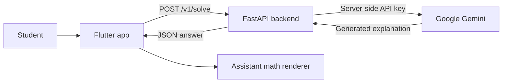

<!--
  SolveLens — project README
  Keep screenshots in docs/screenshots/ and update the paths below when you add them.
-->

<p align="center">
  
</p>

<h1 align="center">SolveLens</h1>
<p align="center"><strong>See Problems. Get Answers.</strong></p>
<p align="center">
  An AI-powered mathematics companion built with Flutter, FastAPI, and Google Gemini.
</p>

<p align="center">
  
  
  
  
  
  
</p>

<p align="center">
  <a href="#features">Features</a> ·
  <a href="#architecture">Architecture</a> ·
  <a href="#screenshots">Screenshots</a> ·
  <a href="#getting-started">Getting started</a> ·
  <a href="#roadmap">Roadmap</a>
</p>

---

## About

**SolveLens** is a mathematics-solving app designed to make working through problems feel clear and approachable. Ask a question in the Flutter app, send it to the SolveLens API, and receive an AI-generated explanation powered by Google Gemini.

The project is organized as a Flutter client and a separate Python backend. The backend keeps the Gemini credential off the device and provides a small, documented API for solving questions.

> **Project status:** Active development. The current codebase includes a working text-question flow and a server-side Gemini integration. Camera, gallery, voice input, accounts, and saved conversation history are not implemented yet.

## Features

- **Ask math questions:** Enter a problem in the app and submit it to the solver.
- **AI-powered answers:** The FastAPI service sends the question to Google Gemini and returns the generated answer.
- **Readable math responses:** Assistant output passes through a dedicated renderer for prose and mathematical content.
- **Conversation view:** User prompts and assistant responses appear in an in-memory conversation during the current app session.
- **Light and dark visual themes:** A purple, blue, and pink identity with a math-inspired home screen.
- **Clear API error handling:** Network failures, timeouts, invalid responses, and server errors are mapped to user-facing messages.
- **Testable service boundary:** A shared solver interface supports a fake implementation for UI tests and a remote implementation for the API.

### Not implemented yet

Camera capture, gallery uploads, microphone/speech recognition, authentication, cloud-saved chat history, and production deployment are future work—not current features.

## Tech stack

| Layer | Technology | Purpose |
|---|---|---|
| Mobile / UI | Flutter + Dart | Cross-platform application |
| Math display | `flutter_math_fork` | Rendering mathematical notation |
| HTTP client | Dart `http` | Calls the SolveLens API |
| Backend | Python + FastAPI | Validates requests and exposes solve endpoints |
| AI provider | Google Gemini | Generates math explanations |
| Backend SDK | `google-genai` | Communicates with Gemini |
| Testing | Flutter Test + pytest | Client and backend tests |

## Architecture

The Gemini API key stays on the server. The Flutter app receives only the API base URL; it must never contain the provider secret.



### Request lifecycle

1. The user enters a question in the Flutter app.
2. `RemoteSolveService` sends `{ "question": "..." }` to `POST /v1/solve`.
3. FastAPI validates the question and applies configured length limits.
4. The backend calls Google Gemini using the server-side `GEMINI_API_KEY`.
5. The API returns `{ "answer": "..." }`; the Flutter app renders the response.

## Screenshots

Screenshots of the running application will be added here. Capture the app on an emulator or device and save the images in `docs/screenshots/`.

| Home screen | Solving a question |
|---|---|
| _Coming soon — add `docs/screenshots/home.png`_ | _Coming soon — add `docs/screenshots/solve-flow.png`_ |

To display your screenshots, add the image files to `docs/screenshots/` and replace the placeholders above with:

```md


```

## Getting started

### Prerequisites

- Flutter SDK compatible with the Dart SDK constraint in `pubspec.yaml`
- Python 3.10 or newer (use a version supported by the installed dependencies)
- A Google Gemini API key
- Android Studio / an Android emulator, or another supported Flutter device

### 1. Clone the repository

```bash
git clone https://github.com/Aditya090908/SolveLens.git
cd SolveLens
```

### 2. Set up the backend

```bash
cd server
python3 -m venv .venv
source .venv/bin/activate
# Windows PowerShell: .venv\Scripts\Activate.ps1

pip install -r requirements.txt
cp .env.example .env
```

Open `server/.env` and add your Gemini API key:

```env
GEMINI_API_KEY=your_gemini_api_key
# Optional; defaults to gemini-3.5-flash-lite in the current backend config
GEMINI_MODEL=gemini-3.5-flash-lite
```

**Keep this key private.** Never commit `.env`, paste the key into source code, or pass it to Flutter using `--dart-define`. The repository ignores local environment files; only `server/.env.example` belongs in Git.

### 3. Start the API

From the `server/` directory, with the virtual environment activated:

```bash
uvicorn app.main:app --host 0.0.0.0 --port 8080 --reload
```

Check that the service is running:

```bash
curl http://127.0.0.1:8080/health
```

Expected response:

```json
{ "status": "ok" }
```

### 4. Run the Flutter app

Open a second terminal at the repository root:

```bash
flutter pub get
```

For an **Android emulator**, use the emulator's host bridge address:

```bash
flutter run --dart-define=SOLVELENS_API_BASE_URL=http://10.0.2.2:8080
```

For a **Linux desktop** build:

```bash
flutter run -d linux --dart-define=SOLVELENS_API_BASE_URL=http://127.0.0.1:8080
```

For a **physical Android device**, replace the host with your development computer's reachable LAN IP address, and ensure both devices can reach each other on the network.

The API base URL is a non-secret runtime setting. The Gemini API key must remain in the backend environment.

## API reference

### Health check

`GET /health`

Returns:

```json
{ "status": "ok" }
```

### Solve a question

`POST /v1/solve`

Request:

```json
{
  "question": "Solve 2x + 3 = 7. Show the steps."
}
```

Success response:

```json
{
  "answer": "..."
}
```

Errors use a structured response:

```json
{
  "error": {
    "code": "invalid_request",
    "message": "A non-empty question is required."
  }
}
```

Example request:

```bash
curl -X POST "http://127.0.0.1:8080/v1/solve" \
  -H "Content-Type: application/json" \
  -d '{"question":"Solve 2x + 3 = 7. Show the steps."}'
```

## Running tests

### Flutter tests

From the repository root:

```bash
flutter test
```

### Backend tests

From the `server/` directory, with the virtual environment activated:

```bash
pytest
```

Some regression scripts may call external services; check each test's name and setup before running any live/provider-dependent tests.

## Configuration

| Variable | Where it is used | Description |
|---|---|---|
| `GEMINI_API_KEY` | Backend only | Required Google Gemini API key |
| `GEMINI_MODEL` | Backend only | Gemini model name; defaults to `gemini-3.5-flash-lite` in current config |
| `MAX_QUESTION_LENGTH` | Backend only | Maximum accepted question length; default is 4000 |
| `MAX_OUTPUT_TOKENS` | Backend only | Output token cap; configured in backend settings |
| `SOLVELENS_API_BASE_URL` | Flutter build/run | Base URL of the SolveLens backend; contains no secret |
| `SOLVELENS_USE_FAKE_SOLVER` | Flutter build/run | Enables the fake solver when configured |

## Roadmap

The following are planned directions, not promises of a release schedule.

- [x] Flutter app foundation and branded home screen
- [x] Light and dark themes
- [x] Text-based question submission
- [x] FastAPI solve endpoint
- [x] Server-side Gemini integration
- [x] Client-side math-aware assistant response renderer
- [x] Flutter and backend test suites
- [ ] Add real screenshots and a short demo
- [ ] Camera capture and gallery image input
- [ ] Voice input
- [ ] Conversation persistence and history
- [ ] Production backend deployment with HTTPS, monitoring, and rate limiting
- [ ] Improve automated evaluation of mathematical answer quality

## Project documentation

- [Product requirements](docs/PRD.md)
- [Design specification](docs/DESIGN.md)
- [Backend setup and API notes](server/README.md)

## Contributing

Issues, suggestions, and pull requests are welcome. For substantial changes, open an issue first to discuss the proposed approach.

When contributing:
1. Keep provider credentials out of the Flutter client and Git history.
2. Add or update tests for behavior changes.
3. Update the documentation when setup or API behavior changes.

## License

No license has been selected for this repository yet. Until a license is added, the default copyright rules apply and reuse should not be assumed to be permitted.

---

<p align="center">
  Built with curiosity, mathematics, Flutter, and Gemini.
  <br />
  <strong>SolveLens — See Problems. Get Answers.</strong>
</p>
