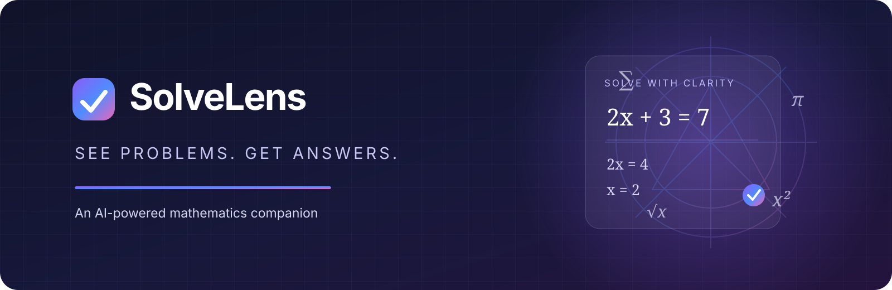
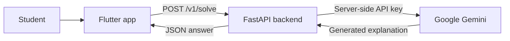

<p align="center">
  
</p>

<h1 align="center">SolveLens</h1>
<p align="center"><strong>See Problems. Get Answers.</strong></p>
<p align="center">An AI-powered mathematics companion built with Flutter, FastAPI, and Google Gemini.</p>

---

## Overview

SolveLens is a mathematics-solving application that helps students ask questions and receive AI-generated explanations. The repository contains a Flutter client and a separate Python backend. The backend keeps the Gemini API credential server-side and exposes a small API for solving text questions.

**Current status:** The text-question flow and server-side Gemini integration are implemented. The project is under active development.

## Implemented Features

- Submit typed mathematics questions from the Flutter app.
- Generate answers through a FastAPI backend connected to Google Gemini.
- Render assistant responses with support for prose and mathematical notation.
- Display user prompts and assistant responses in an in-memory conversation during the current app session.
- Light and dark themes.
- User-facing handling for network failures, timeouts, invalid responses, and server errors.
- A testable solver boundary with fake and remote implementations.
- Flutter and backend test suites.

## Not Implemented Yet

Camera capture, gallery uploads, microphone or speech recognition, authentication, cloud-saved conversation history, and production deployment are planned work, not current features.

## Technology

| Layer | Technology |
|---|---|
| Mobile application | Flutter, Dart |
| Math rendering | flutter_math_fork |
| HTTP client | Dart http |
| Backend API | Python, FastAPI |
| AI provider | Google Gemini |
| Provider SDK | google-genai |
| Tests | Flutter Test, pytest |

## Architecture



The Gemini API key belongs only in the backend environment. Never embed it in the Flutter application or commit it to Git.

## Getting Started

### Prerequisites

- Flutter SDK compatible with the project's Dart constraints
- Python 3.10 or newer
- Google Gemini API key
- Android Studio and an Android emulator, or another supported Flutter device

### Clone

```bash
git clone https://github.com/Aditya090908/SolveLens.git
cd SolveLens
```

### Configure the backend

```bash
cd server
python -m venv .venv
# Windows PowerShell: .venv\Scripts\Activate.ps1
# Linux/macOS: source .venv/bin/activate
pip install -r requirements.txt
cp .env.example .env
```

Set the key in `server/.env`:

```env
GEMINI_API_KEY=your_gemini_api_key
```

Use the model configured by the current backend settings (or set `GEMINI_MODEL` explicitly). Do not commit the real `.env` file.

### Start the API

From the `server/` directory:

```bash
uvicorn app.main:app --host 0.0.0.0 --port 8080 --reload
```

Health check:

```bash
curl http://127.0.0.1:8080/health
```

### Run Flutter

From the repository root in another terminal:

```bash
flutter pub get
flutter run --dart-define=SOLVELENS_API_BASE_URL=http://10.0.2.2:8080
```

For a physical Android device, use the development computer's reachable LAN IP instead of the emulator host address.

## API

### `GET /health`

Returns service health.

### `POST /v1/solve`

Request:

```json
{ "question": "Solve 2x + 3 = 7. Show the steps." }
```

Success response:

```json
{ "answer": "..." }
```

## Tests

Flutter tests (repository root):

```bash
flutter test
```

Backend tests (server directory):

```bash
pytest
```

## Roadmap

- [x] Flutter application foundation
- [x] Text-question submission
- [x] FastAPI solve endpoint
- [x] Server-side Gemini integration
- [x] Math-aware assistant response rendering
- [x] Flutter and backend tests
- [ ] Add current screenshots and a project demo
- [ ] Camera capture and gallery image input
- [ ] Voice input
- [ ] Persistent conversation history
- [ ] Production deployment, monitoring, and rate limiting
- [ ] Automated evaluation of answer quality

## Documentation

- [Product requirements](docs/PRD.md)
- [Design specification](docs/DESIGN.md)
- [Backend setup and API notes](server/README.md)

## Author

**Aditya Kumar** · [GitHub](https://github.com/Aditya090908)
